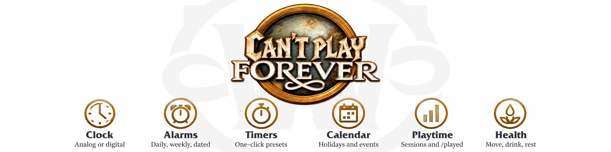

# Can't play Forever

  

Clock with multiple alarms and timers for World of Warcraft Forever (Interface 16001). Optional Health module for movement, hydration and eye-break reminders with faction-aware icons.

Repository: <https://github.com/N3zr0k/CantPlayForever>

## Funktionen

Siehe [docs/Funktionen.md](docs/Funktionen.md). Änderungen: [CHANGELOG.md](CHANGELOG.md).

## Installation

Ordner `CantPlayForever` nach `Interface/AddOns/` kopieren.

## Entwicklung

* `python3 tools/check.py` prüft Struktur, TOC-Versionen, Lua-Klammern und Locale-Schlüssel.
* `python3 -m unittest discover tests` führt die Tests aus, `luacheck .` die Lint-Prüfung.
* Release-Regeln: Version `vX.Y.Z-PHASE.N`, Details in [docs/Files.md](docs/Files.md) und den Workflows unter `.github/`.
* Repo-ZIP: `python3 tools/build_repo_zip.py <Version>`.

## Dokumentation

* [docs/Funktionen.md](docs/Funktionen.md)
* [docs/OAPDebug.md](docs/OAPDebug.md) – optionale externe Debug-Zentrale
* [docs/Files.md](docs/Files.md)
* [docs/CURSEFORGE.md](docs/CURSEFORGE.md)

## Lizenz

MIT, siehe [LICENSE](LICENSE).
